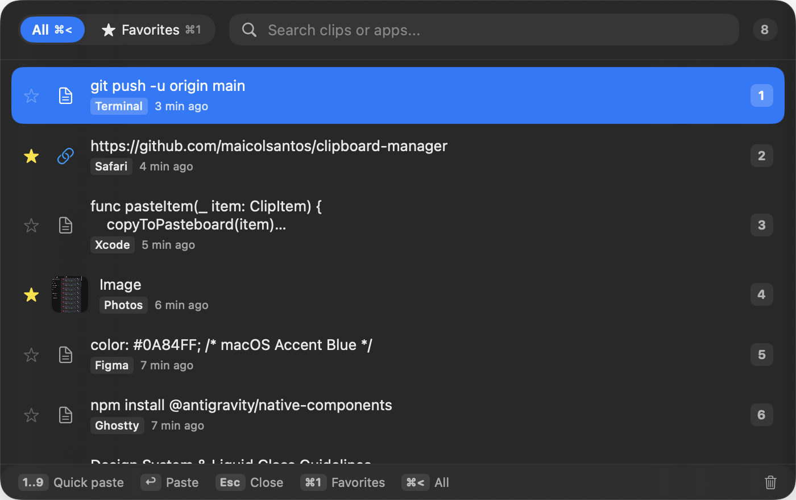

# Clips — Native macOS Clipboard Manager

A lightweight, blazing-fast, native macOS clipboard manager built with **SwiftUI** and **AppKit**. Designed to be calm, distraction-free, and keyboard-first. 100% local, private, and offline.

<p align="center">
  
</p>

---

## ✨ Features

- **⚡️ Global Quick Access**: Press `⌘⇧V` (`Cmd + Shift + V`) from anywhere to summon the floating panel on top of all windows.
- **🚀 Instant Auto-Paste**:
  - Press `1` through `9` on opening to immediately paste the corresponding clip into your previous active app.
  - Navigate with arrow keys (`↑` / `↓`) and press `Enter` (`↩`) to paste immediately.
  - Single-click any clip in the list to paste it instantly.
- **⭐ Favorites (`⌘1` / `⌘<`)**:
  - Star clips to keep important snippets handy.
  - Press `⌘1` to jump directly to **Favorites**.
  - Press `⌘<` to jump back to **All clips**.
  - Starred clips are never automatically pruned.
- **🔍 Instant Filter & Search**: Type anytime to instantly filter clips by text content or source application.
- **🛡️ Privacy & Password Manager Aware**:
  - Runs completely offline with no servers, trackers, or cloud sync.
  - Automatically filters out sensitive items copied from password managers (1Password, Bitwarden, KeePass, `org.nspasteboard.ConcealedType`).
- **⚙️ Configurable History Limit**: Keeps 100 items by default, configurable in **Settings > General** (25, 50, 100, 200, 500, or 1000 items).
- **🖱️ Smooth Dismissal**: Press `Esc` or click anywhere outside the window to dismiss it immediately.

---

## ⌨️ Keyboard Shortcuts

| Shortcut | Action |
| :--- | :--- |
| `⌘⇧V` (`Cmd + Shift + V`) | **Open / Toggle Clips** (Global hotkey) |
| `1` .. `9` | **Quick paste** item 1 through 9 directly into target app |
| `↑` / `↓` | **Navigate** through history items |
| `↩` (`Return`) | **Paste** selected item immediately into target app |
| `⌘1` | Filter by **Favorites** |
| `⌘<` | Filter by **All clips** |
| `Esc` | **Close** clipboard panel |
| `⌘,` | Open **Settings** window |
| `Click outside` | Dismiss window |

---

## 🛠️ Requirements

- macOS 14.0 (Sonoma) or newer.
- **Accessibility Permission**: Required by macOS for synthetic auto-paste (`CGEvent`). Clips will prompt you on first launch or via the banner in the footer.

---

## 🚀 Building & Installing

Clips has no external third-party dependencies. It is built as a standalone Swift Package and App bundle.

### 1. Build and install to `~/Applications/Clips.app`

```bash
# Clone the repository
git clone https://github.com/maicolsantos/clipboard-manager.git
cd clipboard-manager

# Build, sign ad-hoc, and install into ~/Applications/Clips.app
./build.sh

# Or build and launch immediately:
./build.sh --open
```

### 2. Run Self-Tests & Unit Tests

```bash
# Run unit tests
swift test

# Run real system function checks on isolated /tmp store
./tools/selftest.sh
```

---

## 🏗️ Architecture

- **`App.swift`**: Menu Bar Extra life-cycle, status bar menu, and Settings window scene.
- **`FloatingPanelController.swift`**: Manages the custom `ClipboardFloatingPanel` (`NSPanel`), key event routing, global click-outside detection, and `.popUpMenu` window elevation.
- **`HotkeyCenter.swift`**: Carbon `RegisterEventHotKey` integration for global `⌘⇧V`.
- **`ClipboardHistory.swift`**: Pasteboard monitoring (`NSPasteboard`), content hashing, deduplication, item limits, and target app reactivation.
- **`ClipsView.swift`**: SwiftUI interface with vibrancy, keyboard navigation, and instant paste gestures.
- **`SyntheticPaste.swift`**: Low-level `CGEvent` synthesis for seamless pasteboard injection into active applications.

---

## 📄 License

MIT License. Feel free to use, modify, and distribute.
